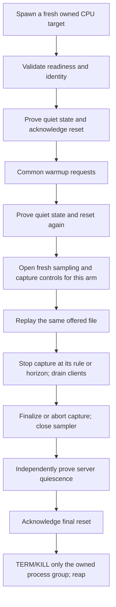

# Experiment-arm lifecycle and reset checks — step 016

Implemented and validated using owned CPU subprocess/HTTP fixtures only. The adapter launches only the bundled fake target; it cannot attach to a GPU service or launch Nsight/vLLM. CPU fixtures are not an experimental hardware baseline. Real GPU lifecycle/coverage/reset validation, interval wait/prefill instrumentation, diagnosis calibration and protocol freeze remain pending.

## Distinct arm plans

[experiment_arms.py](../tracing/experiment_arms.py) defines eight validated `ArmPlan`s:

| Arm | Target capture capability | Cheap sampling during playback | Control |
|---|---|---|---|
| `no_profiler` | Disabled | None; sampler factory is not invoked | Common client request measurement only |
| `cheap_only` | Disabled | Fresh queue/utilization sampling session | Monitor closed cheap windows, no heavy capture decisions |
| `fixed_burst` | Bounded | Fresh session | Shared FB policy |
| `repeated_fixed_burst` | Bounded | Fresh session | Shared RFB policy |
| `stability_stop` | Bounded | Fresh session | Shared SS policy |
| `counter_recovery_stop` | Bounded | Fresh session | Shared CR policy |
| `hybrid_stop` | Bounded | Fresh session | Shared HS policy |
| `full_horizon_reference` | Continuous | Fresh session | Begin before requests, request stop at first observed horizon, finalize independently |

Capture-disabled controls reject capture RPCs at the target, rather than merely omitting capture calls while retaining a profiler-enabled launch. The two controls use the same disabled target executable mode; their client-side instrumentation differs. All arms share the same exact offered file, horizon, playback settings, warmup requests, target service settings and shared policy budget configuration. A comparison-contract hash checks those values; fresh target/sampler identities and completed cleanup are separately checked by `require_comparable`.

The CPU demo uses a three-attempt incident cap and 10 ms requested spans to exercise mechanics quickly. It does not replace the draft GPU study's proposed settings. MU remains an SS(K=2) compatibility alias and cannot become a ninth arm. The policy fixture uses the existing streaming controller and an explicitly abstaining kernel-summary classifier. The richer typed T2 join remains separately tested; calibrated diagnosis is not integrated by this lifecycle step.

## Owned lifecycle



Every arm gets a new target process, session nonce, instance ID and output directory. Reset generations advance three times in a successful run: initial reset, reset after common warmup, and final reset after workload cleanup/quiescence. Warmup/counter reset has no claim of resetting real model/KV caches; the fake target has no GPU/model cache. Two observed warmup latencies provide the synthetic controller's baseline solely to exercise activation; they are not an independently calibrated GPU healthy reference.

[arm_session.py](../tracing/arm_session.py) launches the bundled [fake target](../scripts/fake_serving_target.py) using argv, no shell, with a new owned POSIX process group and bounded readiness. The readiness file/HTTP status must match the actual `Popen` PID, nonce, instance, capture mode, protocol and expected generation. The endpoint must be explicit loopback HTTP. A caller cannot pass an arbitrary PID for termination.

Stopping a policy capture is separate from terminating serving. [target_capture.py](../tracing/target_capture.py) issues acknowledged capture start/stop commands in the **same fake serving process**, waits for a finished synthetic report, parses/persists it and assigns evidence readiness. Capture stop leaves request handling alive. Failed/cancelled control is not assumed to have stopped tracing; cleanup explicitly aborts capture, then independently waits for the target's report/work counters to become quiet. Uncertain captures poison new capture starts.

The full-reference arm starts capture before playback, requests stop at the first serviced horizon crossing, and waits for report completion after playback as needed. Scheduling jitter and RPC latency make these control boundaries wider than the exact requested horizon; actual host events are retained. Post-horizon reference evidence does not enter online decisions. A full reference trace remains a perturbed instrument, not diagnosis ground truth.

## Quiescence is server evidence, not client task count

The fake target deliberately continues queued/running work after a timed-out or disconnected client. `live_request_tasks=0` therefore does not establish server idleness. Before any accepted reset, the session requires:

- Correct current target PID/nonce/instance/generation and capture mode.
- Explicit finite integer `running`, `queued`, `inflight`, `report_pending` and capture counters; `inflight == running + queued`.
- Zero queued/running/inflight work, zero pending reports and `capture_active == false`.
- At least two valid quiet observations over a configured minimum hold interval, before a bounded deadline. Any busy observation resets the streak and hold clock.

Missing counters, booleans masquerading as counts, stale identities/generations or inconsistent status fail validation. No missing metric defaults to zero. Quiet polling observes actual parent response receipt timestamps; server state is not backdated. It is still a finite observation gate, not a mathematical guarantee that arbitrary distributed/GPU work is absent.

Reset itself has a fresh token and must return the next generation, zero counters and inactive capture. The acknowledgement is validated before accepting the new generation, followed by another quiet gate. A stale/reset-rejected response fails the arm; it does not silently continue into a later block. Failed startup/reset/quiescence attempts retain their result/timing files and still tear down the owned target.

## Cleanup and timing evidence

Cleanup is shielded against cancellation. Only the owned target group receives TERM, followed by bounded KILL escalation if necessary; the direct child is reaped and group absence must be confirmed. An OS permission/visibility error is unknown liveness, not confirmed absence: it is logged and retried within the cleanup deadline. Persistent uncertainty fails cleanup. Descendants escaping their owned group require additional real-target tracking and are not certified by this fixture.

The initial CPU development matrix exposed such a permission-denied cleanup check. Its [original failed result](../examples/arm_lifecycle_demo/development_failures/initial_cleanup_visibility/results.json) and [follow-up](../examples/arm_lifecycle_demo/development_failures/initial_cleanup_visibility/FOLLOWUP.json) are retained. The corrected handler and a forced visibility-denial regression require subsequent confirmed absence. Original source hashes were recorded for that development attempt; a full executed-source archive was not saved. This failure is not included among the eight clean final arm runs.

Artifacts retain source/contract/report fingerprints, real child PID, launch argv, warmup receipts, raw playback/feature data, server quiet observations, reset acknowledgements and stage timings. Separate host scopes include startup, resets, warmup, reference start/finalize, workload plus drain, capture/sampler cleanup, server quiet wait and owned target cleanup. Raw request horizon/drain timestamps remain separate in playback. Capture-control spans include RPC/report-finalization latency; synthetic report parse/persistence have explicit events. There is no real Nsight export measurement. GPU active time and total persisted lifecycle stay null. Overlapping phase scopes are not additive.

No environment/credential dump is recorded. Local CPU sampler sessions have unique identities and close after each arm; the unprofiled arm opens none. Actual NVML sessions and real device quiescence still need their own validated adapter on the next hardware run.

## Reproduce and inspect

From the repository root, use a new output directory:

```bash
python3 -m experiments.scripts.demo_arm_lifecycles --output /tmp/my_cpu_arm_lifecycles
python3 -m unittest experiments.tests.test_arm_lifecycles -v
```

The [saved report](../examples/arm_lifecycle_demo/REPORT.md), [summary](../examples/arm_lifecycle_demo/SUMMARY.json), [plan](../examples/arm_lifecycle_demo/matrix_plan.json) and [offered file](../examples/arm_lifecycle_demo/offered_arrivals.json) show eight fresh targets and seven fresh samplers. FB produced one fixture capture; the other four policies produced three each with unknown diagnoses; the reference produced one capture. Four injected failures—missing metric, persistent busy status, stale reset and startup failure—are saved in separate failure directories. All final owned groups are gone. These are CPU mechanics outcomes, not measured policy quality, profiler perturbation or GPU transfer.

Step 017 implements [durable evaluator reference locking and offline scoring](LOCKED_REFERENCE_SCORING.md) using synthetic fixtures. Steps 018–019 add [interval metric collection, persistence and initial-stop export wiring](ARM_COLLECTION_AND_EXPORT.md) on CPU. Step 020 prepares [gated pinned-stack discovery](LIVE_FEASIBILITY.md). Next: step 021, actual L4 capability discovery; owned activity validation remains pending. Real reference quality, phase attribution and classifier calibration must be established before GPU confirmation.
